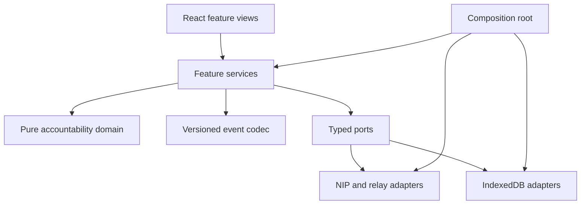

> Stage 4 implementation amendment (10 October 2026): M4 also includes the approved three-category/five-goal UI refresh and explicit Practice/app-format versioning. The native NIP-07 adapter, account IndexedDB port and shared WSS publisher retain documented tooling substitutions; no new crypto is introduced. Deterministic write-path checks pass; actual extension, hosted browser/CSP and live-pilot exit checks remain pending. Stage 5 still owns NIP-46 and NIP-42.

# Goalstr Prototype — Build Plan

Version 1.1 · 9 October 2026 · Based on PRD v1.1 and the NostrBlocks reference prompt

Build a working, mobile-first Nostr accountability app through small, runnable milestones. The product loop is **plan → check in → review**. The engineering loop is **explain → implement → verify → teach**. Each increment must leave the application usable and add a concrete lesson about the protocol or the product's own rules.

This is the implementation plan for the existing PRD. It specifies the stack, module contracts, build order, educational features, tests, deployment work, and extension roadmap.

## 1. What we carry over from the reference

| Reference idea | Decision for this prototype |
| --- | --- |
| Portable React frontend | Vite + React + TypeScript; GitHub repository and Vercel static deployment target |
| Protocol LEGO blocks | Small NIP adapters behind typed interfaces; one modular application, not separate services |
| Real Nostr primitives | Use the nostr-tools project for events, signatures, relay transport, identifiers, and remote signing; no custom cryptography |
| Learn through runnable increments | Every milestone includes a concept, working demonstration, protocol example, tradeoff, exercise, and checkpoint answer |
| Explore before connecting | Preserve the PRD's interactive, local Practice mode, plus unsigned live browsing |
| Optional remote signer in the reference | Keep NIP-46 in P0, alongside NIP-07, to satisfy our mobile requirement |
| localStorage preferences | Use IndexedDB for drafts, public event cache, outbox, and account-scoped settings; reserve localStorage for simple non-sensitive display preferences |
| Inspect the protocol | Optional action explanations, a sanitized developer inspector, NIP cheat sheet, and printable guide |
| Add infrastructure only when necessary | P0 uses external signers and relays but needs no app backend, paid AI, wallet, or image host |
| Implement all selected blocks | Trace every P0 requirement to a milestone; retain P1 features as explicit, gated extensions |

Photo chains, groups, calendar events, wiki publishing, and geocaching belong to the reference product. Our selected blocks are identity, relays, public daily state, social interactions, and recovery. Learning material must explain the blocks this application actually uses.

## 2. Stack and infrastructure decisions

| Layer | Choice | Purpose and boundary |
| --- | --- | --- |
| Frontend | Vite, React, strict TypeScript | Fast local development and a portable static application |
| Navigation | React Router, declarative routes | Today, People, History, Profile, day detail, Settings, and Learn |
| Styling | CSS Modules + shared CSS tokens | Charcoal surfaces, solid colors, accessible controls, one completion ring; no gradient theme |
| Domain | Plain TypeScript | Commands, progress rules, schedule rules, state transitions, and deterministic reconstruction |
| Nostr SDK | nostr-tools project, pinned release and subpath imports | Verify events; manage relays; implement NIP helpers and remote signer transport |
| Validation | Zod at application input and event-codec boundaries | Reject invalid or unsupported payloads before state mutation |
| Persistent storage | IndexedDB through `idb` | Transactions, versioned stores, durable drafts and exact signed outbox events |
| UI state | React state and service subscriptions | Keep ephemeral form state in views; services own persisted operations and projections |
| Unit/integration tests | Vitest + React Testing Library | Domain, codec, service, signer, storage, and meaningful UI behavior |
| Browser tests | Playwright | Practice journey, failure recovery, routes, and desktop/mobile viewport checks |
| Accessibility | Automated browser checks plus manual keyboard/screen-reader checks | Verify the ritual works without pointer, motion, or color alone |
| Repository/CI | GitHub + GitHub Actions | Reproducible installs, type checks, lint, tests, and production build |
| Hosting | Vercel static Vite deployment | HTTPS frontend; browser connects directly to configured WSS relays |
| Learning guide | Markdown sources + printable `/learn` route | Copyable examples and browser Print / Save as PDF |

The upstream nostr-tools documentation currently uses `@nostr/tools` and JSR installation. M0 must verify the released package, package source, API exports, and bundling with our npm workflow, then record the exact dependency in the lockfile. Use its documented installation route rather than assuming the old package name or copying outdated API calls. Wrap SDK calls so a package change does not reach the domain or React views. [Technical references 2–3]

Use one supported Node release across local development, CI, and Vercel; the initial compatibility floor is **Node 22.12 or newer**, then pin the chosen supported release in M0. This satisfies the currently documented Vite and Vitest minimums. Pin compatible dependency versions after the integration checks rather than relying on floating `latest` during later builds. [Technical references 1, 4]

P0 has no app-owned identity key service. The user approves signatures through an external signer. NIP-46 needs a separate client session key for its encrypted transport; keep that key and connection secrets **in memory only**, reconnect after reload, and destroy them on disconnect. The user's identity private key never enters the app. Signed outbox events and drafts still persist independently of the signer session.

External relay retention, acceptance, and signer uptime remain dependencies. Choose and document actual pilot relays and signer applications during the integration milestones. A static host supplies the frontend; it does not supply reliable background reminders, identity custody, wallet services, or media storage.

## 3. Architecture and repository structure

The application is a modular monolith. React views call feature services. Services combine pure domain rules, codecs, and ports. Concrete NIP, storage, and relay adapters are assembled in the composition root. Network calls never originate in view components.



Arrows from ports to adapters show runtime delegation. The dependency rule is stricter: concrete adapters implement the port interfaces; domain code cannot import them.

| Path | Responsibility |
| --- | --- |
| `src/app/` | Routing, dependency assembly, mode/account lifecycle, error boundaries |
| `src/domain/accountability/` | Types, commands, invariants, progress, transitions, reconstruction, conflict rules |
| `src/domain/ports/` | SDK-independent signer, relay, storage, clock, and diagnostics interfaces |
| `src/features/today/` | Plan/update/review composers, corrections, carry-forward, daily card |
| `src/features/people/` | Following/Public feeds, replies, encouragement |
| `src/features/history/` | Calendar/list, recap, rest-day and closed-day summaries |
| `src/features/profile/` | Public metadata, public day history, follow controls, sharing |
| `src/features/settings/` | Signer, relays, timezone, reminders, local data and mute controls |
| `src/protocol/accountability/v1/` | App schema, encode/decode, deterministic readable text, contract fixtures |
| `src/protocol/nips/{01,02,07,09,10,11,19,21,25,42,44,46,65}/` | Scoped NIP implementations and their capability descriptions |
| `src/infrastructure/relays/` | SDK pool wrapper, bounded subscriptions, retry/backoff, destination observations |
| `src/infrastructure/storage/` | IndexedDB migrations, transactions, drafts, outbox, account isolation |
| `src/infrastructure/diagnostics/` | Sanitized operation events and optional pilot measurement |
| `src/practice/` | Isolated local adapter, sample scenarios, deliberate simulated failures |
| `src/learning/` | Action explanations, inspector, cheat sheet, printable guide |
| `src/ui/` | Shared accessible controls, typography, surfaces, ring, status labels |
| `tests/{fixtures,integration,e2e}/` | Signed fixture corpus, fake adapters, browser scenarios |
| `docs/{architecture,contracts,lessons,decisions}/` | Module design, event contracts, milestone lessons, decision records |
| `docs/NIP_MAP.md`, `docs/LEARN.md` | Protocol coverage and printable tutorial source |
| `docs/ACCEPTANCE.md` | F01–F12 and A01–A24 evidence |
| `README.md`, `vercel.json`, `.github/workflows/` | Setup, static routing/hosting, and CI |

Create extension folders when their features begin. Define the required seams now; avoid empty integrations that imply working payments or private features.

### Port and module contracts

Retain the PRD's `SignerPort`, `RelayPort`, and `AccountabilityCodec` interfaces. Add typed storage repositories and an injectable clock. Expose cancellation and progress through service-level operation states without leaking SDK objects into the UI.

- **SignerPort:** connect, discover actual user public key, sign the requested event, disconnect; report supported operations, denial, timeout, and identity changes.
- **RelayPort:** bounded query, subscription with cleanup, publication with per-destination results. Query results include individual relay completion/failure; publication is never a single Boolean.
- **StoragePort:** account/mode-scoped drafts, event cache, observations, outbox, preferences, and local controls. Persist unsigned operation intent before signing and signed bytes before transmission.
- **AccountabilityCodec:** encode a validated command; decode into compatible state, ordinary conversation, unsupported schema, or invalid payload.
- **ClockPort:** date/time and schedule resolution; tests control midnight, timezone changes, future timestamps, and timer suspension.
- **DiagnosticsPort:** structured, sanitized operation observations; no draft text, session keys, private connection URIs, or raw signer RPC payloads.

Every NIP module owns its supported subset, input validation, failure mapping, tests, and short documentation. Enforce import boundaries with lint rules. Build/type-check the pure domain separately from the React application and concrete SDK adapters.

## 4. Protocol block coverage

| Block / module | P0 behavior | Milestone | Fallback or limitation |
| --- | --- | --- | --- |
| NIP-01 | Event verification, kind 0 profiles, wire requests, subscriptions, publication facts | M2–M4 | Relay results are partial observations; verify before ingestion |
| NIP-02 | Preserve the full kind 3 follow list and legacy content when editing | M6 | Failed fetch disables mutation; concurrent external edits cannot be locked |
| NIP-07 | Browser signer public-key access and signing | M4 | Practice/live browsing remain available if absent or denied |
| NIP-09 | Own kind 5 deletion requests; authorize incoming deletions | M7 | Request does not guarantee erasure elsewhere; missing ancestry is visible |
| NIP-10 | Kind 1 plan narrative, author updates, review, and normal reply threads | M2, M6 | Plaintext remains readable in other clients; structured progress needs our codec |
| NIP-11 | Relay information and advertised limits | M3, M5 | Missing/CORS-blocked metadata does not disable transport; runtime rejection still matters |
| NIP-19 / NIP-21 | Public IDs, day/profile links, and `nostr:` URIs | M3, M6 | Validate identifiers; relay hints are untrusted and bounded |
| NIP-25 | Kind 7 `+` encouragement, one active count per author/target | M6 | Other reactions display separately; no duplicate inflation |
| NIP-42 | Selected-relay authentication and refusal handling | M5 | Ask through signer flow; auth events go only to the challenged relay |
| NIP-44 | Tested encryption dependency for remote signer messages | M5 | Public plans remain public; encryption is scoped to signer transport |
| NIP-46 | Remote connect, actual account-key discovery, signing, teardown | M5 | Reconnect after reload; unsupported/denied operations preserve drafts |
| NIP-65 | Read relay lists and route within pool/destination caps | M3, M5 | Limited routing is disclosed; relay-list editing is deferred |
| App schema v1 | Plans, rest, snapshots, revisions, close, correction, resolution | M1–M2 | Explicit application convention; unknown versions are readable but cannot mutate state |

NIP-11 relay advertisements do not establish whether a browser or remote signer supports a client-side signing operation. Record signer capabilities and relay capabilities separately, and verify both through runtime behavior.

P1/extension NIPs are mapped in section 12. This project implements the necessary subset of each NIP; it does not implement a relay server or every optional feature in those specifications.

## 5. Freeze the day-state contract before live publication

Use the PRD's existing kind 1 format:

```ts
['t', 'goalstr']
['t', 'goalstr-v1']
['accountability', '1', eventType, JSON.stringify(payload)]
```

The `accountability` tag is an app-defined convention, not a standardized NIP and not an assumed relay index. Use indexed `t` tags for discovery and indexed `e` references for threading.

M2 must publish an exact JSON schema and fixtures for `plan`, `rest`, `checkin`, `revision`, `close`, `correction`, and `resolve`. Freeze nested field names for task IDs, slots, bonus records, reflection fields, and carry-forward references; the PRD describes their rules but is not yet a complete machine-readable schema. Write down the names before implementing encode/decode or sharing events with pilot users.

The contract fixtures must include:

- A three-task root with immutable original wording, UUID task IDs, date, timezone, and resolved reminder instants.
- A full update snapshot with original/current wording, statuses, original fulfillment, bonus records, slot selection, parent ID, and sequence.
- Close, correction, and conflict resolution, preserving closure and revision history.
- Rest roots with no task updates or invented completion percentage.
- Normal conversation without app state; unknown versions; malformed and oversize payloads.
- Foreign-author state attempts, missing parents, deleted ancestors, competing updates, and duplicate roots.

The reducer must select the PRD's deterministic branch: at each fork choose greatest `created_at`, then lexically lowest event ID. Preserve competing valid branches. Enforce author identity, matching root, causal parent, sequence, increasing timestamps, full original task set, closure rules, and the five-minute future-time policy. Re-evaluate quarantined future events as the clock advances; do not confuse clock policy with signature validity.

Completion comes only from fulfilled original commitments. Check-in markers, bonus tasks, and Closed are independent. Revised completion earns original credit only after explicit confirmation. Public signatures establish authorship and signed content, not accomplishment or independently verified time.

Validate the **whole serialized signed event** against the 16 KiB ceiling and stricter destination limits. Unicode code-point limits are separate from UTF-8 byte limits. Estimate envelope overhead before asking for a signature and check actual bytes afterward. Never silently truncate or change signed content to fit a relay.

Keep unreadable/unsupported state separate from readable narrative. Never manufacture a confirmed projection from an update whose parent is missing.

## 6. Milestone sequence and release gates

| Milestone | Runnable result | Main dependencies | PRD stage |
| --- | --- | --- | --- |
| M0 — Foundation | Repo, app shell, contracts inventory, reproducible toolchain | None | Preparation |
| M1 — Practice ritual | Complete local day, History, rest, correction, carry-forward | M0 | Stage 1 |
| M2 — Protocol model | Codec, signed fixtures, reconstruction, conflicts, learning inspector | M1 | Stage 2 |
| M3 — Read real Nostr | Public browsing, profile/day links, relay diagnostics | M2 | Stage 3 read path |
| M4 — Browser signing | Real plan/update/review, durable outbox, honest statuses | M3 | Stage 3 write path |
| M5 — Mobile signing | NIP-46 plus authentication and routing on tested devices | M4 | Stage 3 complete |
| M6 — Social loop | Following/Public feeds, preserved follows, encouragement, threaded replies | M5 | Stage 4 |
| M7 — History and controls | Live recaps, reminders, mute/hide, deletion, recovery controls | M6 | Stages 4–5 |
| M8 — Reliability gate | Full acceptance matrix, failure recovery, security, accessibility | M7 | Stage 5 |
| M9 — Deploy and teach | Reproducible deployment, complete guide, pilot-ready demonstration | M8 | Stage 5 exit |

Order is dependency-based, not a fixed calendar. Re-estimate after the signer/relay spike. Practice and read-only previews are useful early increments; the P0 prototype is complete only after M9's gate passes.

### M0 — Foundation and compatibility spike

**Build:** Scaffold the Vite React TypeScript project; routes and semantic navigation; tokens and accessible shared controls; strict type/lint scripts; CI skeleton; dependency assembly and typed ports. Record SDK version/package route, reviewed NIP revisions, schema namespace, signer-session policy, relay caps, and hosting choice in decision records. Add an initial `NIP_MAP.md`, event-contract inventory, and lesson template.

**Spike:** Confirm the selected SDK exposes event verification, relay cleanup/results, NIP-46 transport, and NIP-44 primitives. Identify candidate browser/remote signer applications and relay endpoints for later runtime tests. Pin Node/package versions after this check; do not hardcode assumptions from old tutorials.

**Verify:** Clean install, separate domain type-check, lint, production build, navigation at 360 px, and import-boundary check.

**Exit:** A new contributor can run the shell using the README. The stack and unresolved integration checks are recorded, and every P0 block has an owner module and milestone.

### M1 — Complete the ritual in Practice mode

**Build:** Domain types and commands; one-to-three-task composer; revision/original-fulfillment prompt; bonus tasks; check-in markers; close/correct; rest day; tomorrow's selected carry-forward; calendar/list and recap. Add local draft persistence, temporary-session fallback, timezone/date handling, and fixed schedules per day. Match the PRD's single-ring design and simple public-visibility copy.

**Isolation:** Practice uses a separate namespace and local adapter. No signer, relay subscription, or fake network acknowledgment is needed. Example cards are labeled separately from the user's practice day. Switching to live offers an explicit copy into a new draft; nothing publishes automatically.

**Learning:** Add optional action explanations using clearly labeled example data. Practice progress labels describe local state, not relay delivery.

**Verify:** A01–A05, A12, A13, A18, A22–A24 locally; screen-size and keyboard checks; meaningful browser test of plan → revision → update → review → tomorrow.

**Exit:** A newcomer completes the full local ritual without network access, refresh recovers the draft when storage works, and the ring never conflates check-ins or closure with task completion.

### M2 — Event contracts and deterministic reconstruction

**Build:** Versioned schema, codec, readable text generator, signature-validation boundary, graph reducer, duplicate-root selection, competing branches, resolution command, missing-parent retrieval intent, and completeness warnings. Add a fixed signed fixture corpus generated with test-only identities. Keep test keys out of the production bundle.

**Learning:** Make fixture events inspectable; mark simulated, unsigned, and verified signed examples distinctly. Explain which fields Nostr standardizes and which our application defines.

**Verify:** Codec/text consistency; all event types; malformed tags/versions; foreign authors; full task-set preservation; shuffle and duplicate invariance; branch tie-breaks; closure transitions; deletion authorization and incomplete ancestry. Test UTF-8 size limits and unsupported-schema safe fallback. A06–A08, A15, A17, A19, A21–A22 at contract level.

**Exit:** The same verified event set always yields the same projection. Ordinary replies cannot change task state. The exact schema and sample event files are reviewable before any live write.

### M3 — Read the real network

**Build:** WSS relay pool; small configurable bootstrap list; NIP-11 information; NIP-65 relay-list reads; signature-verified ingestion; bounded `#t` discovery and `#e` thread fetches; missing-parent fetches; profile hydration; basic public feed; validated NIP-19/NIP-21 links. Fetch visible-card updates first and batch profiles. Provide empty, partial, unsupported, disconnected, and error states.

**Bounds:** Eight active relays maximum; configurable query window; twenty initial cards; overlap pagination boundaries and deduplicate by event ID. Track per-relay EOSE/timeouts, backoff with jitter, cancellation, and unmount cleanup. Preserve a warning when same-second limits prevent complete retrieval.

**Learning:** Display real event IDs and relay observations in the opt-in inspector. Explain why the Public tab is only a view of configured relays and why EOSE does not prove global completeness.

**Verify:** Fake relay scenarios cover reordering, duplicates, disconnect, EOSE, missing metadata, capped pages, and route teardown. Read real pilot fixtures and open a day/profile URL without signing in.

**Exit:** Real public data is clearly distinct from Practice. Network views have bounded resources and honest partial/error states.

### M4 — Browser signer and reliable publication

**Build:** NIP-07 adapter; actual key discovery; first-publication acknowledgment; exact preview; event verification; account-scoped drafts; durable outbox; recovery by event ID; plan/update/revision/close/correction/resolution publication. Verify the returned pubkey, ID, signature, kind, content, tags, and timestamp match the requested event.

**Transaction:** Persist operation intent → request signature → verify returned event → persist exact signed bytes → send to destinations → persist each result. One positive relay acknowledgment allows Published with replication detail. No acknowledgment means Not confirmed. Retries reuse the same event; block creation of a second root while an uncertain root is unresolved.

**Learning:** Explain the distinction between signed, sent, accepted, and observed later. Show a sanitized publication trace instead of treating signer approval as delivery.

**Verify:** Absent signer, denial, timeout, altered fields, identity change, one accepted/two failed relays, possible delivery before timeout, refresh between each transaction boundary, exact-event retries, and public cache-clear reconstruction. A09–A11, A14, A18, A24.

**Exit:** A real browser signer publishes a whole day on test relays. Refresh cannot silently lose persisted signed work or report an unacknowledged operation as Published.

### M5 — Remote signer, authentication, and routing

**Build:** NIP-46 adapter with tested NIP-44 dependency; supported connection URI flow; QR/deep-link connection where supported by the selected signer; connection cancellation and reconnect guidance; actual user-key discovery; kind-scoped permission requests; in-memory credentials; teardown. Keep signer transport identity distinct from the publishing account.

**Relay work:** Finish NIP-65 routing for author write relays and targeted recipients' read relays, within four ordinary write destinations. Handle NIP-42 challenges only for selected/configured relays with signer approval, on that connection. Surface relay advertised/runtime limits and limited distribution. Include kind 22242 signing only when relay authentication is enabled.

**Learning:** Explain encrypted signer messages versus public day notes. Redact connection tokens, session keys, permission links, and RPC bodies in diagnostics and export.

**Verify:** Run the full plan/update/review on at least one actual mobile remote-signer flow; test signer denial, disconnect, permission/authentication refusal, timeout, returned-key mismatch, reload, logout, and targeted routing limits. Reload reconnects signing while persisted drafts/outbox remain intact.

**Exit:** Both NIP-07 and NIP-46 work on documented tested devices. Denial returns a recoverable composer. Authentication events never appear in ordinary public-note publication.

### M6 — Social interaction and public navigation

**Build:** Complete Following/Public feeds, stable card ordering by root publication, Load more, public profiles and history, NIP links, NIP-02 follow/unfollow, NIP-25 encouragement/removal, and NIP-10 normal replies to a plan or individual update. Hydrate missing profiles safely; distinguish foreign replies from author state.

**Follow safety:** Refetch the latest known full list before signing, preserve unrelated tags and legacy content, and show detected concurrent changes. A failed query is not an empty list. If no list is observed after successful bounded queries, explicitly say it is not found on checked relays before the user chooses to create one; do not imply globally proven absence.

**Learning:** Explain public follows, replaceable-list races, thread markers, and the difference between a reaction and an accomplishment claim.

**Verify:** Preserve a 100-entry list; deny writes on failed fetch; handle concurrent lists; one card per author/day; root and direct-parent reply placement; reaction deduplication; safe unknown-client reactions; no auth required for shared links. A06, A08, A16, A21.

**Exit:** Two real pilot identities can follow, see a day, encourage it, and reply to an update. Another compatible client can read the plaintext narrative and reply structure.

### M7 — History, reminders, local controls, and deletion

**Build:** Complete live calendar/list/recaps, closed-day and rest-day counts, late review, account-scoped timezone/reminder settings, prompts while the app is open, local mute/hide, clear-cache/clear-local-data controls, and kind 5 deletion requests for eligible owned events. Validate all incoming deletion requests before applying them; retrieve them for known roots, updates, replies, and reactions.

**Recovery:** Rebuild disposable projections from reachable verified events. Cache clearing must not silently discard drafts/outbox. Explain which unsent/local settings cannot be reconstructed. Deleted ancestors leave an Incomplete record with last reconstructable state rather than a confident final result.

**Reminder behavior:** Recompute due prompts when a suspended tab becomes visible. Published day schedules remain fixed; settings edits affect future plans. No prompt posts an event. State plainly that background delivery is outside P0.

**Learning:** Add examples for deletion requests, device-local hiding, and the difference between public recovery and unsent draft recovery.

**Verify:** Own versus forged deletion, deleted parent, root deletion, suppression across feed/profile/links/history, cache replay, multiple accounts, denied storage, midnight, changed timezone, rest/empty dates, and missing notification support. A13–A14, A17, A22–A24.

**Exit:** History reflects accepted state; local controls apply consistently; deletion and reminder copy describe their actual limits.

### M8 — Reliability, security, accessibility, and performance gate

**Build/fix:** Close acceptance gaps; deterministic service-level failure scenarios; safe text/link/profile rendering; restrictive CSP compatible with configured relay connections; resource cleanup; redacted diagnostics; account-switch isolation; storage migration and quota handling; accessible modal/focus/error behavior.

**Verify:** All A01–A24; unsafe HTML/link/schema fixtures; secret-free logs and inspector exports; teardown and repeat navigation; keyboard and screen reader core ritual; reduced motion; contrast; Chrome/Safari/Firefox; 360 px layout; actual mobile remote signer. Measure the PRD budgets: cached Today within one second, local interaction within 100 ms, initial content within three seconds on the agreed device/network profile. Report signer/network delay separately.

Use deterministic fake signers/relays for repeatable CI and a short real-integration smoke suite for evidence. Random public-relay availability must not determine whether a deterministic regression test passes.

**Exit:** The acceptance ledger includes evidence and tested environment. No unresolved issue can corrupt day state, lose persisted pending work, expose signer credentials, or falsely claim publication.

### M9 — Deployment, learning guide, and pilot handoff

**Build:** Complete README, NIP map, architecture/event docs, ten milestone lessons, cheat sheet, and printable Learn route. Configure Vercel build/output and SPA rewrites for direct links, headers/CSP, HTTPS/WSS behavior, public-only configuration, and a rollback procedure. All `VITE_*` values are client-visible configuration, never secrets.

**Release checks:** Clean checkout → install → type-check/lint/tests → production build. On the hosted candidate, reload each direct route; check practice isolation; execute a live day using both tested signer paths; recover an outbox item; verify a second-client reply; clear public cache and reconstruct. Keep the inspector off by default in the pilot build.

**Pilot:** Prepare five-person moderated tasks and a seven-day, roughly ten-to-twenty-person pilot using the PRD's success criteria. Use moderated/local measurement by default; optional remote analytics needs an explicit opt-in design and excludes draft content and credentials. Track usability, return/closure, publication honesty, and reconstruction separately from task completion.

**Exit:** A working deployment and reproducible repository are ready to review, all P0 coverage is evidenced, and the printable guide can teach the implemented protocol from the actual code.

## 7. Teaching deliverables and acceptance

Learning serves both the person using the app and the person learning to build it. The normal daily flow stays concise. Explanations are optional, and no quiz is required to plan, post, or close a day.

| ID | Deliverable | Acceptance |
| --- | --- | --- |
| E01 | Collapsible “What happens on Nostr?” panel | Available for connect, publish plan/update/review, follow, reply, encourage, delete, and recover; shows kind, relevant tags, signature state, publicness/encryption scope, and app-defined fields |
| E02 | Development/Practice protocol inspector | Shows connection/subscription state, safe examples, validation, and destination results; never reveals keys, connection secrets, raw RPC bodies, or unsent text without deliberate local viewing |
| E03 | NIP cheat sheet | Each implemented subset has official link, one-sentence purpose, code-module link, and a Try it exercise; planned extensions are marked Planned |
| E04 | Practice mode | Persistently labeled; fixtures, local interaction, and live events remain distinct; no automatic publication on connection |
| E05 | Milestone lessons | Concept, runnable demo, illustrative request/event, tradeoff, exercise, question, and short answer for M0–M9 |
| E06 | Printable learning guide | Browser print produces readable architecture, flow, examples, security notes, and setup/deployment steps without clipped code or unusable dark backgrounds |

Use bounded inspector buffers and sanitize data **before** storage/logging. Default action panels show synthetic examples; actual local event inspection is a deliberate developer action. The inspector must not become an analytics stream.

### Milestone lesson outline

The following are teaching examples, not a substitute for validated full fixtures. Wire placeholders such as `signedEvent`, `rootId`, and `authorHex` must be replaced by valid values in executable lesson examples.

| Milestone | Concept and illustrative example | Tradeoff / exercise | Checkpoint and answer |
| --- | --- | --- | --- |
| M0 | Dependency boundaries: a signer contract with `signEvent(unsignedEvent)` | More explicit interfaces; swap the concrete signer for a fake | Does the domain need the SDK? No; it depends on domain types and ports. |
| M1 | Local ritual: `completeTask(taskId, { originalFulfilled: true })` | Practice gives no network portability; finish two of three originals and add a bonus | Does a bonus make the ring 100%? No; the ring remains 2 of 3. |
| M2 | NIP-01 envelope + app tag: `['accountability','1','checkin',payloadJson]` | Portable narrative, app-specific structured state; inspect a foreign-author update | Is the day payload a NIP? No; it is a versioned application convention. |
| M3 | Discovery: `['REQ','learn-feed',{kinds:[1],'#t':['goalstr-v1'],since:windowStart,limit:20}]` | Bounded retrieval can omit history; compare two relays | Does EOSE mean every event exists here? No; it ends that relay's stored response. |
| M4 | Publication: `['EVENT', signedEvent]` then `['OK', eventId, true, '']` | External approval adds delay; reject a signature and retry one failed destination | Does signing mean Published? No; publication needs an acceptance or explicitly labeled recovered observation. |
| M5 | Remote signer: `get_public_key` / `sign_event` via encrypted NIP-46 RPC | Reconnection after reload; compare transport key and returned account key | Are the day's tasks encrypted? No; only the remote-signing transport is encrypted here. |
| M6 | Social: kind 3 `p` entries; kind 7 `+`; kind 1 marked `e` root/reply references | Follow-list races; preserve an existing list and reply to a specific update | Can a follower's reply complete a task? No; only valid author state changes the projection. |
| M7 | Deletion: kind 5 with `['e', eventId]` and target-kind tags | Erasure is not guaranteed; delete an intermediate state fixture | Can the UI promise removal everywhere? No; it can issue a request and explain incomplete history. |
| M8 | Verification pipeline: signature → schema → author/parent/transition → projection | Strict policy excludes some signed data; shuffle duplicates and inject a forged state change | Is a valid signature enough? No; domain and causal rules must also pass. |
| M9 | Hosted recovery: ID query `{ids:[rootId],limit:1}` after public-cache clearing | Reachable relays may omit data; rebuild one live day and print the guide | Can relays recover an unsent draft? No; the draft was never published. |

Write the lesson as each milestone is implemented. The final guide combines those lessons with the actual files and tested behavior, rather than describing hypothetical features.

## 8. Publication and recovery behavior to implement

| UI state | Evidence | Allowed next action |
| --- | --- | --- |
| Draft | Successful local save, or explicit temporary-session label | Edit, preview, discard |
| Awaiting signature | Validated unsigned operation persisted; signer request pending | Wait or cancel safely |
| Signed, pending | Returned event verified and exact signed bytes persisted | Send; retain operation if interrupted |
| Published | At least one positive relay acknowledgment for this event | Show destination replication; retry failed destinations |
| Not confirmed | No positive acknowledgment; failure/timeout may conceal delivery | Query by event ID; retry exact event; do not manufacture another root |
| Recovered confirmation | Same verified event retrieved later from a relay | Explain observed availability and retain its real observation time |
| Incomplete record | Known root/ancestor/state dependency unavailable or deleted | Show last reconstructable state, warning, and fetch/retry path |

Confirmed History and public projections use accepted or observed valid events. Pending local outcomes are visibly provisional. An account switch stops old subscriptions, cancels active operations where possible, and isolates data; a previously signed event is never silently repurposed for another account.

## 9. PRD traceability

| Requirement | Primary milestones | Acceptance evidence |
| --- | --- | --- |
| F01 Identity/signers | M4–M5, M8 | Denial/mutation A09; both real signer flows; account/session teardown |
| F02 Plan composer | M1, M2, M4 | A01, A13, A24; title/size/date validation and draft recovery |
| F03 Day card/updates | M1–M2, M4 | A01–A04, A06–A08 |
| F04 Check-in schedule | M1, M7 | A02, A13; distinct-slot markers and resumed-tab prompts |
| F05 Revisions | M1–M2, M4 | A03, A05; original wording/credit preservation |
| F06 Close/correct | M1–M2, M4, M7 | A12, A22; explicit closure and labeled correction |
| F07 Feeds/profiles | M3, M6–M7 | A06, A08, A21; paging, stable sort, safe profile fallback |
| F08 Follows | M6 | A16; preserved full list, failed-fetch and concurrency behavior |
| F09 Encouragement/replies | M6–M7 | Thread placement, unique active reactions, removal via deletion |
| F10 History/rest | M1, M7 | A13–A14, A22–A23; closed versus rest versus empty dates |
| F11 Publish/recovery | M3–M5, M8 | A07–A11, A14–A15, A18, A24 |
| F12 Local controls/deletion | M7–M8 | A17, A19, A24; consistent hiding and cache/control separation |

All A01–A24 must have a passing result or documented evidence in `docs/ACCEPTANCE.md` before M9. A20 is verified across the complete interface in M8, with accessible controls checked from M0 onward. E01–E06 are additional educational requirements carried over from the reference, without weakening any PRD acceptance condition.

## 10. Verification strategy

| Layer | Tests that matter |
| --- | --- |
| Domain | Denominator preservation, revised fulfillment, bonus exclusion, closure/correction, schedule/date boundaries, rest and duplicate roots |
| Codec/reducer | Signed fixture decoding, text/payload agreement, versions/size limits, wrong author, missing/deleted parent, closure transitions, forks, shuffled/duplicated arrival |
| Services | Durable transaction boundaries, exact retry, query recovery, identity switching, cancellation, per-relay acknowledgment truth |
| Adapter contracts | Signer denial/mutation/timeouts; relay EOSE/rejection/auth/cleanup; storage denial/quota/migrations; SDK exports |
| UI/browser | Full practice and live ritual, preserved form input, routes, thread placement, temporary storage, safe rendering, keyboard/reduced motion |
| Real integration | Two tested signer paths, configured pilot relays, recipient routing, compatible-client readability, deployed direct links, cache reconstruction |

Provide reusable fake ports with configurable acceptance, timeout-after-delivery, rejection, duplicate, missing-parent, and clock scenarios. Keep automated assertions tied to observable requirements; do not add tests merely to repeat implementation details.

Expected repository commands: `npm run dev`, `npm run typecheck`, `npm run lint`, `npm run test`, `npm run test:e2e`, `npm run build`, and `npm run preview`. Use a lockfile and `npm ci` in CI. The separate domain check must not pull in React or SDK adapter imports.

## 11. Integration risks and closure work

| Risk | Required action | Completion gate |
| --- | --- | --- |
| SDK package/API drift | Verify current published install path and required exports; pin and wrap | M0 |
| Incomplete nested schema definitions | Freeze names/limits and publish full fixtures before live writes | M2 |
| Remote signer differences | Test actual mobile approval, permissions, auth, reconnect, and account key | M5 |
| Relay omission/rejection/retention | Select tested endpoints; retain per-destination observations and completeness warnings | M3–M5 |
| Browser storage denial/eviction | Detect successful writes; temporary-session label; never promise unsent relay recovery | M1, M7–M8 |
| Follow-list concurrent edits | Refetch/preserve, expose detected changes, document lack of transactions | M6 |
| Clock/DST/tab suspension | Inject clock; freeze published date/schedule; resolve ambiguous local times explicitly | M1, M7–M8 |
| Teaching UI overload or credential exposure | Optional panels, synthetic defaults, pre-log redaction, bounded inspector | M2, M5, M8 |
| Static-host route/CSP errors | Deep-link rewrite and hosted WSS/signing smoke checks | M9 |

Where a local reminder time is ambiguous or nonexistent due to daylight saving changes, choose and document a deterministic policy before publishing the day's resolved instants. This is an application scheduling decision, not a Nostr rule. It must not silently change the date between preview and signing.

## 12. Planned extensions after P0

Build these as subsequent increments after pilot evidence. They are planned coverage, not required for the M9 prototype gate. Each gets its own contract, lesson, tests, interoperability limits, and operational dependencies.

| Increment | Product capability / seam | Protocol and infrastructure | Gate before enabling |
| --- | --- | --- | --- |
| P1-A | Templates and weekly review | Pure domain/local storage; no new NIP required | Reused goals get new IDs; rest/closed counts remain honest |
| P1-B | Supporting photos and links | MediaPort, validated URLs, chosen upload/hosting service; select metadata NIPs after design | Explicit hosting cost/permissions; avoid location leakage; actual accessible media flow |
| P1-C | Zaps and optional wallet | Separate ZapPort NIP-57 and WalletPort NIP-47 | Recipient/request/receipt validation; wallet denial/timeout handling; no success without proper confirmation |
| P1-D | Background reminders | NotificationPort; service worker/push/backend as needed for supported platforms | Permission and delivery behavior tested; do not promise reliable closed-tab timers from a static page |
| P1-E | Encrypted preference sync | PreferenceSyncPort; NIP-78 candidate with encryption/access and recovery design | No plaintext private preferences; signer support and cross-device decryption verified |
| P1-F | Lightweight achievements | Local achievement rules first; NIP-58 only if portable badges are justified | App interpretation is explicit; no universal trust or accomplishment-proof claim |
| Extension | Synced mute/report controls | NIP-51 / NIP-56 | Scope, privacy, and moderation semantics designed and tested |
| Extension | Comments for other root kinds | NIP-22 | Revisit thread codec only if product objects move away from kind 1 |
| P2 | Private circles, challenges, monetary commitments, social login, native apps | Separate product/security proposals | Membership, encryption, custody, recovery, abuse, and platform design approved before build |

Future private messaging requires the relevant complete encryption/routing design. A Following filter or private-looking screen cannot make public plan events private. Wallet identity and credentials must remain separate from signer identity and session credentials.

## 13. Execution brief for the eventual build

Act as a React/TypeScript engineer, Nostr implementer, and technical educator. Implement this plan in order, keeping the app runnable at every milestone. Use the PRD for product rules and this plan for build structure. Before each milestone, explain the concept in plain language. Deliver the working increment, run the relevant checks, show one illustrative event/request, state a tradeoff, and add the exercise/checkpoint to the guide.

Start with M0 and then complete M1's entire Practice ritual. Do not jump straight to a network-dependent UI. Implement every P0 block and document all P1 seams. Do not substitute placeholders for live signing, relay acknowledgments, conflict resolution, or recovery. Keep NIP adapters separate from the app-defined day schema, use tested library cryptography, and preserve the reference's education-first discipline.

For each milestone handoff, report: what now works, which NIP subset or domain rule it demonstrates, how it was checked, and any remaining integration limitation. At M9, deliver the deployable repository, hosted review candidate, acceptance ledger, and printable guide.

## 14. Sources and technical references

Product source: `Goalstr_Prototype_PRD.md`, version 1.1. Teaching/stack source: the attached **NostrBlocks — Coding agent starter kit / PhotoRelay** prompt. This plan transfers its engineering and educational approach to our accountability product; milestone order, module decisions, and acceptance gates are application design decisions.

Current official technical documentation reviewed for the plan:

1. [Vite getting started](https://vite.dev/guide/) — React TypeScript scaffold and runtime compatibility.
2. [nostr-tools upstream repository](https://github.com/nbd-wtf/nostr-tools) — current package/import guidance, event verification, relay pool, and remote signer helpers.
3. [Official Nostr specifications](https://github.com/nostr-protocol/nips) — pin reviewed revisions in M0; in particular [NIP-46](https://github.com/nostr-protocol/nips/blob/master/46.md) and [NIP-44](https://github.com/nostr-protocol/nips/blob/master/44.md).
4. [Vitest getting started](https://vitest.dev/guide/) — Vite integration and current runtime minimum.
5. [Playwright installation](https://playwright.dev/docs/intro) — browser test setup.
6. [React Router declarative installation](https://reactrouter.com/start/declarative/installation) — client-side routing.
7. [React Testing Library introduction](https://testing-library.com/docs/react-testing-library/intro/) — behavior-oriented component tests.
8. [idb upstream repository](https://github.com/jakearchibald/idb) — promise-based IndexedDB wrapper.
9. [Zod documentation](https://zod.dev/) — schema validation.
10. [Vite on Vercel](https://vercel.com/docs/frameworks/frontend/vite) — deployment and SPA deep-link rewrites.

Specifications and package APIs are living sources. The implementation's reviewed revisions and lockfile, not this document's date, define the exact versions used by the build.
